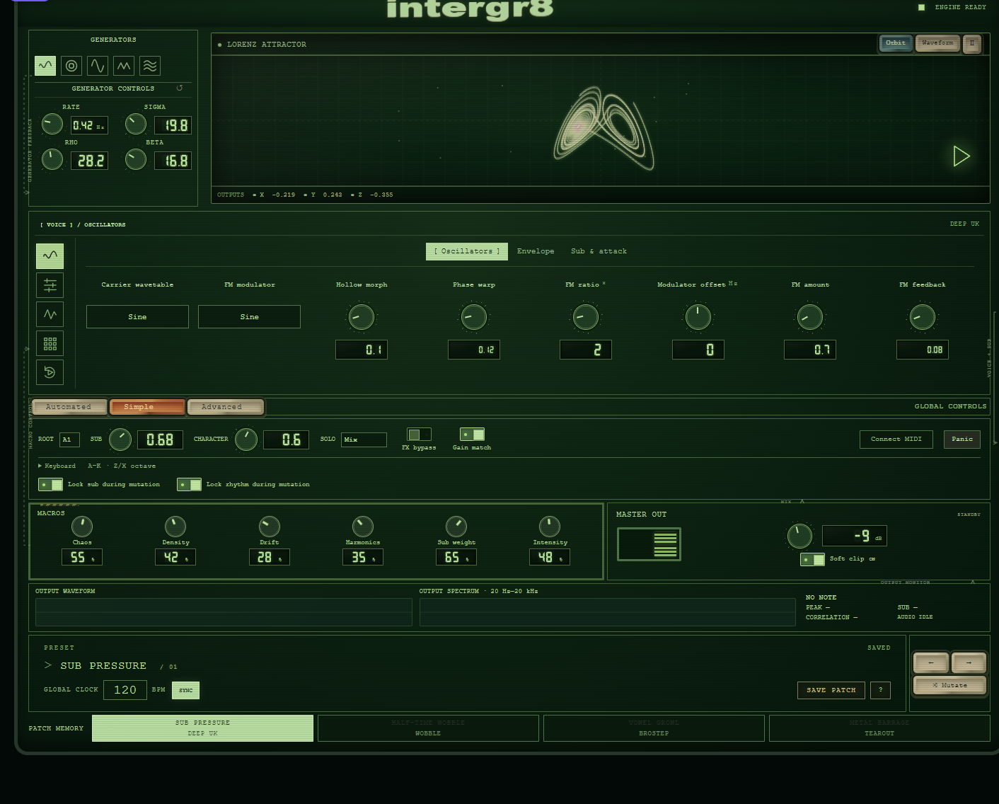

# intergr8

A standalone browser bass instrument with a worn, cassette-futurist hardware interface. No build step, no package manager, no dependencies — open it on a local web server and play.



intergr8 is a monophonic bass synth running entirely in the browser. It pairs a small modulation matrix of five generator families with a dedicated bass voice: an FM wavetable carrier, an independent mono sub, a three-band distortion stage with reorderable processing, a 16-step phrase sequencer, and a granular resampler that can capture its own output.

It began as **Black Box**, a modulation-instrument prototype kept as `black-box-prototype.zip`; the current code lives in [instrument/](instrument/), and `motherbox.zip` is a snapshot export of its `dist/` build.

---

## Quick start

intergr8 uses `AudioWorklet`, which browsers only allow on `localhost` or HTTPS. Opening `index.html` from disk will not make sound.

```bash
# any static server works
cd instrument/dist
npx serve .            # or: python3 -m http.server 8000
```

Then open the printed address, click **▶** (or press `Space`), and play `A W S E D F T G Y H U J K`.

| Action | Control |
| --- | --- |
| Play notes | `A W S E D F T G Y H U J K` or the on-screen keyboard |
| Change octave | `Z` / `X` |
| Start / stop transport | `Space`, or the ▶ button in the waveform panel |
| Panic (all notes off) | **Panic** in the global rack |
| Hardware keyboard | **Connect MIDI** (Web MIDI, Chrome/Edge) |

## Features

**Sound design**

- Independent mono sub and stereo character layers, with layer solo, crossover, separate envelopes, velocity, legato, glide, phase reset and pitch bend.
- Wavetable carrier/modulator pair (six tables, 48 partials), audio-rate FM with feedback, phase warp and hollow morph, plus transient and pitch-attack layers.
- Low/high/band/notch filter, vowel formants, comb resonator, all-pass dispersion, three-band distortion, multiband dynamics, stereo width, and a filtered dub delay.
- Reorderable processing chain and selectable 1× / 2× / 4× nonlinear oversampling.
- Four factory banks — **Deep UK**, **Wobble**, **Brostep**, **Tearout**.

**Sequencing and modulation**

- Sixteen-step phrases on straight or triplet grids with swing, note/velocity/gate/retrigger editing and per-step FM and cutoff locks.
- Five generator families (chaotic attractors, Euclidean rhythm, quadrature LFO, custom waveform, sub oscillator) with six macros: Chaos, Density, Drift, Harmonics, Sub weight, Intensity.
- A routing matrix from any generator output to any generator parameter or bass destination, with depth, polarity, inversion, lag and linear/exponential/stepped curves.

**Performance and analysis**

- Real output waveform, log spectrum, peak, sub RMS and stereo correlation readouts.
- Gain-matched FX bypass, constrained mutation that can lock the sub and rhythm.
- Named local patch library with modified-preset indication, JSON backup download, and browser persistence. Captures are stored inside the patch.

**Resampling**

- Capture or import up to eight seconds, trim and reverse a region, then play it back granularly with independent travel speed and pitch. Export the selected region as WAV.

## Architecture in one paragraph

`instrument/dist/index.html` loads [app.js](instrument/dist/app.js) (state, generator math, presets, visualization), [patch-ui.js](instrument/dist/patch-ui.js) (patch identity, save/load, library), and [bass-core.js](instrument/dist/bass-core.js) (all DSP, shared by the AudioWorklet and the Node tests). [bass-worklet.js](instrument/dist/bass-worklet.js) wraps the engine in an `AudioWorkletProcessor`; [bass-ui.js](instrument/dist/bass-ui.js) owns audio boot, MIDI, keyboard input and the analysis panels. The remaining small scripts are progressive UI layers that re-arrange and re-skin the DOM (rotary controls, seven-segment readouts, the CRT panel, printed signal traces). Full detail: [docs/ARCHITECTURE.md](docs/ARCHITECTURE.md).

## Tests

No test framework, just Node assertions against the real DSP and patch code:

```bash
cd instrument
node check-bass.cjs      # DSP: silence, pitch, timbre, envelopes, sequencer, modulation matrix, distortion models, sample playback
node check-patches.cjs   # patch state: modified tracking, save/load round trip, tempo, captured audio
node check.cjs           # 100,000 engine samples, preset loading, view switching
```

All three pass, last verified on Node 26. They run offline — `bass-core.js` has no DOM or audio-callback dependencies, which is why it is loadable from both the worklet and Node.

## Browser support

| Browser | AudioWorklet | Web MIDI | Notes |
| --- | --- | --- | --- |
| Chrome / Edge | Yes | Yes | Recommended |
| Firefox | Yes | No | On-screen keyboard only |
| Safari | Yes | No | Requires a user gesture to resume audio |

## Limitations

- Monophonic browser instrument, not a DAW plugin or a multi-voice sampler.
- Hardware MIDI devices and subjective studio monitoring remain unverified.
- 48-partial wavetables and optional oversampling reduce aliasing; they do not eliminate it.
- Browser storage quotas apply to saved patches that contain captured audio.
- The Orbit/Lorenz portrait is illustrative; only the output analysis panels measure real audio.

## Repository layout

```
README.md               this file
CONTRIBUTING.md         development workflow and house style
docs/
  ARCHITECTURE.md       module map, audio graph, DSP and state
  CONTROLS.md           every control, panel and shortcut
instrument/
  dist/                 the app — this directory is what you serve
    index.html          markup and stylesheet/script order
    app.js              generator state, matrix UI, scope, presets
    patch-ui.js         patch identity, save/load, library
    bass-core.js        DSP engine (also required by the Node tests)
    bass-worklet.js     AudioWorkletProcessor wrapper
    bass-ui.js          audio boot, MIDI, keyboard, analysis
    *.css, *.js         progressive UI layers (see docs/ARCHITECTURE.md)
  check*.cjs            Node test harnesses
  *.cjs                 one-off generation scripts that built the UI layers
  docs/                 screenshot used in this README
black-box-prototype.zip the original interface prototype
motherbox.zip           snapshot export of dist/
```

## Documentation

- [docs/CONTROLS.md](docs/CONTROLS.md) — every control, panel and shortcut
- [docs/ARCHITECTURE.md](docs/ARCHITECTURE.md) — module map, audio graph, DSP and state
- [CONTRIBUTING.md](CONTRIBUTING.md) — running, editing, testing and house style

## License

No license file is included yet. Add one before publishing if you intend the code to be reusable by others.
